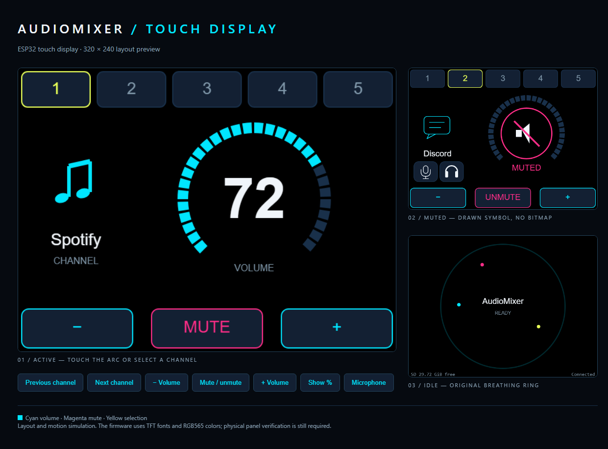

# AudioMixer — controller firmware

Firmware for the physical knob controller that drives the Dialed desktop app. The board
reads pots/encoders and reports them to the PC over USB serial; the PC sets per-app Windows
volumes and (on display-capable boards) echoes back state to render on screen.

There are three firmware **tiers** so the same project works on different hardware. Pick the
folder that matches your board, open its `.ino` in the Arduino IDE (or build with `arduino-cli`),
and flash it.

| Folder         | Board                       | Display                              | Features                                                   |
|----------------|-----------------------------|--------------------------------------|------------------------------------------------------------|
| `mixer/`       | ESP32 (e.g. WROOM)          | GC9A01 240×240 round TFT (TFT_eSPI)  | Full per-app **icons**, accent color, animated arc + idle  |
| `mixer_nano/`  | Arduino Nano / Uno / Pro Mini (ATmega328P) | 1.3" 128×64 I2C OLED (SH1106, U8g2)  | App **name + % + bar gauge** (monochrome). No icons.       |
| `arduino/`     | Any (ESP32/AVR)             | none                                 | Knobs only — minimal sketch, no screen                     |
| `display_test/`| ESP32                       | GC9A01                               | Display bring-up test only                                 |

The tiers exist because of RAM: the ESP32 build stores 64×64 RGB565 icons (32 KB) and a frame
sprite (~16 KB), which cannot fit an ATmega328P's 2 KB SRAM. The Nano build is a slimmed copy of
the same module layout that drops icons/sprites and discards the icon data the PC sends.

## Serial protocol (shared by all tiers)

Baud rate follows the sketch: 921600 for `mixer/`, 115200 for `mixer_nano/` and
`arduino/`. Lines are newline-terminated, with `CultureInfo.InvariantCulture` floats.

**Board → PC**
- `knob1:0.42` — potentiometer absolute level, 0.00–1.00
- `knob1:up` / `knob1:down` — encoder detent
- `knob1:press` — encoder push switch

**PC → Board** (display tiers; knobs-only/Nano ignore what they can't use)
- `vol:knob1:0.42` — authoritative volume echo; drives the on-device gauge
- `assign:knob1:RRGGBB:AppName` — label + accent color for a knob
- `icon:knob1:<base64>` — 64×64 RGB565 icon (~11 KB). **ESP32 only**; the Nano build discards
  these lines without buffering them.
- `screen:off` / `screen:on` — blank + sleep / wake the display around PC suspend, sleep-resume,
  and shutdown. **ESP32 only** (`mixer/`); other tiers ignore it.

Knob ids are 1-based (`knob1`…`knobN`); `MAX_KNOBS` in firmware must cover the highest index used.

---

## `mixer_nano/` — Arduino Nano (ATmega328P)

**Libraries:** [U8g2](https://github.com/olikraus/u8g2) (install via Library Manager).

**Wiring (defaults in the sketch):**

| Function          | Pin(s)        | Notes                                                        |
|-------------------|---------------|-------------------------------------------------------------|
| OLED SDA / SCL    | A4 / A5       | Hardware I2C (fixed on the 328P). OLED `VDD`→5V, `GND`→GND.  |
| Pots              | A0, A1 (…A3)  | Add more in `pots[]`; A6/A7 are also ADC-capable.           |
| Encoder CLK / DT  | D2 / D3       | The only interrupt pins on the 328P. (when `USE_ENCODER 1`) |
| Encoder switch    | D4            | Any spare digital pin.                                       |

Choose pots vs encoders with `#define USE_ENCODER` at the top of `knobs.cpp` (0 = pots, 1 =
encoder). Edit `pots[]` / `encoders[]` to match your build.

**Display note:** 1.3" panels are usually SH1106. If text is shifted ~2px or garbled on the right
edge, your panel is an SSD1306 — change the constructor in `display.cpp` to
`U8G2_SSD1306_128X64_NONAME_F_HW_I2C`.

**Build:**
```
arduino-cli compile --fqbn arduino:avr:nano:cpu=atmega328 Arduino/mixer_nano
```
Use `cpu=atmega328old` if upload fails on an older bootloader. Watch the SRAM report — the U8g2
full buffer is ~1 KB; if you run low, switch `display.cpp` to a page-buffer constructor
(`..._2_HW_I2C`) and a `firstPage()`/`nextPage()` render loop.

## `mixer/` — ESP32

**Libraries:** TFT_eSPI configured for GC9A01. Copy `mixer/User_Setup.h` into your TFT_eSPI
library folder (it overrides the library's default; see the header comment for pin mapping).

**Wiring (defaults in the sketch, WROOM DevKit — 4 encoders + output toggle):**

| Function                 | GPIO                     | Notes                                                              |
|--------------------------|--------------------------|-------------------------------------------------------------------|
| Display SCLK / MOSI      | 18 / 23                  | SPI to the GC9A01. Set in `User_Setup.h`.                         |
| Display CS / DC / RST    | 14 / 27 / 4              | `VCC`→3.3V, `GND`→GND, `BL`→3.3V if the screen stays dark.        |
| Encoder 1 CLK / DT / SW  | 17 / 16 / 5             | `SW` uses `INPUT_PULLUP` (button→GND). GPIO5 is a strapping pin.   |
| Encoder 2 CLK / DT / SW  | 19 / 13 / 21            | Edit `encoders[]` in `knobs.cpp` to match your build.             |
| Encoder 3 CLK / DT / SW  | 22 / 25 / 26            |                                                                   |
| Encoder 4 CLK / DT / SW  | 32 / 33 / 15            | GPIO15 is a strapping pin — don't hold this button while booting. |
| Output toggle (SPDT) COM | 34                       | Center lug→GPIO34, the two throws→3.3V and GND. Input-only pin: no pull-up needed since the toggle drives the line both ways. Emits `switch:0`/`switch:1`. |

All encoder/display `+` lines share the 3.3V rail and all `GND` lines share the ground rail. Avoid
GPIO 6–11 (flash), 1/3 (USB serial), and 12 (strapping, must be LOW at boot). Choose pots vs
encoders with `#define USE_ENCODER` at the top of `knobs.cpp` (0 = pots, 1 = encoder).

**Build:**
```
arduino-cli compile --fqbn esp32:esp32:esp32 Arduino/mixer
```

### Firmware versioning & bundled image

The version lives in `Arduino/mixer/version.h` (`FW_BOARD`/`FW_VERSION`), reported over
serial as `fw:<board>:<version>`. It is the single source of truth for the firmware
version. **Bump it (SemVer) in the same commit as any change under `mixer/`.**

It is deliberately independent of the app's `v*` release tag — tagging `v1.4.0`
may legitimately ship `esp32-mixer-1.0.0.bin` if the firmware did not change.
The firmware CI workflow checks the version bump. Changing the sketch without
bumping would ship two different binaries under one version string and the app's
`fw:<board>:<version>` check will not notice a connected device is stale.

On every tagged `v*` release, `.github/workflows/release.yml` regenerates the bundled
image by running `Arduino/tools/build-firmware.ps1` (using the pinned `arduino-cli` and
the pinned `tools/esptool/esptool.exe` — see `tools/esptool/README.md`), producing
`firmware/esp32/<board>-<version>.bin` and `firmware/esp32/manifest.json`, then attaches
both to the Release. `Dialed.csproj` bundles them next to the exe when present; the app
degrades gracefully if they're absent. You can run the same script locally to produce
the same outputs for local testing, but they are not committed to the repo.

---

## mixer-touch — The less tactile experience

**mixer-touch** is a touchscreen controller variant for Dialed. The current firmware targets
an ESP32-2432S028-family board with an ILI9341 display and XPT2046 resistive touch
controller. ESP32 is a requirement of the current implementation, rather than a
restriction on future mixer-touch variants.

Other ESP32 boards require matching pin assignments, display drivers and touch
configuration; they are not currently validated. Other microcontrollers require
porting the firmware's ESP32-specific components. Additional board profiles can
be supported as they are implemented and tested.

Five channel tabs, a draggable volume arc, minus/plus buttons and MUTE replace
the external knobs. Discord channels include mic mute and deafen touch targets.
`mixer` keeps its existing controller; touch support is enabled separately.
`mixer_nano` remains a separate sketch.

Touch support uses the existing `mixer/mixer.ino` and `mixer/version.h`. Its
additional files have `_touch` names; default mixer files and assets stay in place.
Set `DIALED_CONTROLLER_TOUCH=1` for touch; leaving it unset keeps mixer behavior.
The instructions below apply to touch unless stated otherwise.

### Display preview



This single image is rendered from the
[interactive touch-display preview](../docs/superpowers/prototypes/esp32-touch.html).
It shows the default black-background interface, Spotify as the main example,
Discord on channel 2, and the built-in idle screen. The music/chat symbols are
generic drawings, not Spotify or Discord logos. The values and connection state
are illustrative; this is a layout preview, not a photograph or live device feed.

### Tested hardware

| Component        | Tested board / configuration                                                           |
| ---------------- | -------------------------------------------------------------------------------------- |
| Board family     | ESP32-2432S028-family / common CYD resistive-touch profile                             |
| MCU              | ESP32-D0WD-V3, revision 3.1, dual core, 240 MHz, 40 MHz crystal                        |
| Flash            | 4 MB                                                                                   |
| Display profile  | TFT_eSPI `ILI9341_2_DRIVER`, 320 x 240 landscape, rotation 3, panel inversion enabled  |
| Touch controller | XPT2046, calibrated bounds in `mixer/hardware_profile_touch.h`                         |
| Storage          | 32 GB FAT32 microSD; mounting and free-space reporting verified on the connected board |
| USB serial       | 921600 baud; current touch port COM6, which is a host-specific port assignment                  |
| PSRAM            | Not required; rendering has lower-memory fallbacks                                     |
| Arduino target   | Generic ESP32 Dev Module, `esp32:esp32:esp32`                                          |

This is the tested hardware profile, not a claim that every similarly named board
has the same panel, touch controller or wiring. Other ESP32/S3/C3 boards need a
matching hardware profile. Keep the original `mixer` sketch and its GC9A01
`User_Setup.h` separate from this touch-board configuration.

### Pin assignments

| Peripheral                 | Pins                    |
| -------------------------- | ----------------------- |
| TFT MISO / MOSI / SCLK     | 12 / 13 / 14            |
| TFT CS / DC / backlight    | 15 / 2 / 21             |
| Touch MISO / MOSI / SCLK   | 39 / 32 / 25            |
| Touch CS / IRQ             | 33 / 36                 |
| SD MISO / MOSI / SCLK / CS | 19 / 23 / 18 / 5        |
| RGB LED red / green / blue | 4 / 16 / 17, active low |

Display settings are in `mixer/User_Setup_touch.h`; touch and LED settings are in
`mixer/hardware_profile_touch.h`. SD pins are in `mixer/firmware_config_touch.h`.
The common RGB pin mapping matches
[Espressif's CYD board definition](https://github.com/espressif/arduino-esp32/blob/master/variants/jczn_2432s028r/pins_arduino.h).

### Libraries and tools

| Dependency                   | Locally tested version  | Purpose                                        |
| ---------------------------- | ----------------------- | ---------------------------------------------- |
| Arduino CLI                  | 1.5.1                   | Compile and upload                             |
| Espressif Arduino ESP32 core | 3.3.12                  | ESP32 runtime, GPIO and serial support         |
| TFT_eSPI                     | 2.5.43                  | Display, primitives, sprites and bundled fonts |
| XPT2046_Touchscreen          | 1.4.0                   | Resistive touch input                          |
| SdFat                        | 2.3.0                   | FAT32 SD storage over software SPI             |
| SPI / FS / LittleFS          | Bundled with ESP32 core | Bus and internal-flash storage support         |

The CI setup currently pins ESP32 core 3.3.10; the local builds and hardware checks
listed here used 3.3.12. Do not treat the CI pin as a separate hardware test.
No bitmap/icon package is needed: simple audio symbols use TFT_eSPI primitives,
large numbers use its bundled font, and detailed app artwork comes from the PC.
The unused local bitmap/font copies and unused white touch layout were removed.

### Supported controls

- Five touch tabs select the five hardware channels configured in Dialed.
- The volume arc sets an absolute level; bottom minus/plus buttons support hold-to-repeat.
- The bottom MUTE button controls the selected channel's playback mute.
- On a Discord channel, the microphone icon toggles Discord mic mute and the
  headset icon toggles deafen. Each contact fires once until released.
- Discord icons display confirmed state, with a slash when muted/deafened and a
  question mark when state is unknown or stale. Playback mute is independent.
- Output-device notifications and idle-media upload/playback remain supported.

The desktop app directly accesses Discord's available Windows accessibility
switches without changing foreground focus. This is not an official Discord API
integration. An unavailable or ambiguous switch is reported as unavailable.
Windows audio control still requires the Dialed desktop app.

### Idle screen, connection and power

The built-in idle graphic reuses the original mixer design: a fixed breathing
ring, three drifting dots, and centered AudioMixer / READY text. It uses the
standard black-background palette. Uploaded idle media retains playback priority.

The idle footer shows SD/free-space details on the left and Connected/Disconnected
on the right. Free space refreshes every five seconds. It is not shown over the
active mixer controls or upload screen.

| Condition                      | Display / onboard RGB LED                |
| ------------------------------ | ---------------------------------------- |
| Connected and screen on        | Green LED; normal active or idle display |
| Awake without a PC connection  | Red LED                                  |
| Screen off or PC suspended     | LED off; panel asleep and backlight off  |

There is no heartbeat or automatic screen-off timeout for missing PC commands.
Connection status reflects received PC commands and explicit screen commands;
it cannot detect a silent disconnect while USB power remains present.
`screen:off` holds the display and LED off while serial communication continues.
`screen:on` wakes it on PC resume/reconnect.
There is no separate manual connected-screen-off toggle in the desktop UI.

The desktop firmware dialog offers mixer and touch separately. To bundle both for a
local desktop build, run `Arduino/tools/build-firmware.ps1` and then
`Arduino/tools/build-firmware.ps1 -Controller touch` before building the desktop.
The default `manifest.json` remains mixer; touch uses `manifest-touch.json`.

### Touch build and flash

The current local touch board uses **COM6**. **COM4 is the Arduino Mini**; do not
upload touch firmware to it.

Install the versions above and copy `mixer/User_Setup_touch.h` to the installed
TFT_eSPI library directory. Run from the repository root:

```powershell
$touchSetup = (Resolve-Path 'Arduino/mixer/User_Setup_touch.h').Path.Replace('\', '/')
$touchFlags = '-DDIALED_CONTROLLER_TOUCH=1 -DSPI_DRIVER_SELECT=2 -DMAINTAIN_FREE_CLUSTER_COUNT=1 -DUSER_SETUP_LOADED -include "' + $touchSetup + '"'
arduino-cli compile --fqbn esp32:esp32:esp32 `
  --build-property "compiler.cpp.extra_flags=$touchFlags" `
  Arduino/mixer

arduino-cli upload --fqbn esp32:esp32:esp32 --port COM6 Arduino/mixer
```

The explicit setup include prevents the original mixer configuration from shadowing
the touch configuration. The SdFat flags must apply to the library as well as the sketch. Software SPI
avoids reconfiguring the buses already used by display and touch. Cached free-space
counting runs in bounded background steps under a shared filesystem lock. The
first count can take time, but does not block touch input or serial processing.

For **mixer**, copy `mixer/User_Setup.h` to the
TFT_eSPI library instead, omit the touch/SD flags, and compile `Arduino/mixer`.
The mixer input configuration is in `mixer/knobs.cpp`.

For a merged image and manifest, use PowerShell 7 and
[`tools/build-firmware.ps1`](tools/build-firmware.ps1):

```powershell
./Arduino/tools/build-firmware.ps1
./Arduino/tools/build-firmware.ps1 -Controller touch
```

The helper defaults to **mixer**, applies the matching TFT_eSPI setup and build
flags, and accepts `-ConfigFile` for an alternate Arduino CLI configuration.
It requires the esptool executable described in
[the flashing-tool notes](../tools/esptool/README.md).

The next planned firmware version is **1.4.0** from `mixer/version.h`. Mixer reports
`fw:esp32-mixer:1.4.0`; touch reports `fw:esp32-mixer-touch:1.4.0`.
Image filenames and manifests use these distinct board identifiers. Each build
retains `firmware/esp32/manifest.json` for the desktop bundle. Touch builds additionally
write `manifest-touch.json` and update the active manifest only when explicitly selected.
The release workflow keeps its original default build command. Select touch explicitly
when preparing a touch bundle; do not flash a profile intended for other hardware.
Older touch firmware reported `esp32-mixer`, so its old identifier alone cannot
establish compatibility. First migration requires selecting the correct profile.
The desktop refuses flashing when a connected controller reports an identifier
different from the active bundle's identifier. Unidentified controllers and legacy
touch firmware still require manual hardware/profile verification before flashing.
CI compiles both profiles; local behavioral tests remain outside CI.

### SD storage and memory

Use FAT32 and power off before inserting/removing the card; hot swapping is not
supported. Firmware mounts SD first and falls back to internal LittleFS if needed.
Neither medium is automatically formatted.

| File / data                       | Purpose                                                                                         |
| --------------------------------- | ----------------------------------------------------------------------------------------------- |
| `/idle.dat`, `/idle.tmp`          | Converted idle media and upload staging                                                         |
| `/icon0.bin` through `/icon4.bin` | Current channel app artwork, 64 x 64 RGB565                                                     |
| `/p_NAME.bin`                     | Named controller snapshots, including assignment labels, colours, kinds, output names and icons |
| `/flash-copy.done`                | Records initial idle-media migration so clearing SD media does not restore an old flash copy    |

One 8 KiB icon cache stays in RAM instead of five resident icons, saving 32 KiB.
Display sprites and active rendering buffers still require RAM. SD is storage,
not additional executable RAM. Existing internal idle media is copied once when
appropriate; subsequent SD and internal-flash uploads are independent.

Touch idle media supports the full **320 x 240** landscape panel. The desktop asks
`media?` before encoding; touch replies `media:320:240`, while mixer replies
`media:240:240`. Older firmware ignores this query, so the desktop retains the
**240 x 240** fallback and the mixer's center-crop behavior.
Encoding fills the reported rectangle and center-crops only when the source has
a different aspect ratio. Existing 240 x 240 files still play centered on touch;
re-upload their original source through the updated app to use the full panel.
The idle status footer remains overlaid along the bottom edge.

Firmware accepts up to 64 frames; the current desktop encoder caps at 60 frames
and 20 fps (actual playback depends on storage throughput). A bigger
SD card does not remove these limits or the USB upload bandwidth limit.
Playback throughput still needs physical measurement for each card.

While SD free space is being counted, the idle footer shows "SD calculating free
space", `storage?` replies `storage:sd:pending`, and `gif:space?` replies
`gif:space:pending`. An unreadable FAT or failed worker allocation is reported as
unavailable, not zero free bytes. File writes, truncation, deletion and renaming
invalidate the count and trigger a fresh scan; stale counts are not published.
SD reads yield between sectors, and idle playback renders one band per loop so
large frames cannot monopolize counting, touch or serial processing.
The desktop waits asynchronously for up to five minutes when budgeting an upload,
with cancellation support and a specific retry message if counting is still pending.

Snapshots are device-side serial commands, not a desktop profile picker or a
standalone Windows audio controller. Names contain 1-24 ASCII letters, digits,
underscores or hyphens. Loading a snapshot can be overwritten by the next PC sync.

### Serial commands

The touch profile extends the original protocol; mixer retains its existing
volume, mute, assignment, output, screen and GIF commands. Touch adds `storage?`,
`profile:save/load`, silent `state:knobN:<volume>:<mute>` synchronization,
`cfg:discord:knobN:<0|1>` and `discord:knobN:<mute>:<deafen>` (-1 unknown, 0 off, 1 on).
The desktop handles touch events in `Core/SerialManager.cs`.

921600 baud, newline terminated; channel IDs are one-based (`knob1` to `knob5`).

```text
ver?                     -> fw:esp32-mixer-touch:1.4.0
media?                   -> media:320:240 (touch) or media:240:240 (mixer)
storage?                 -> storage:sd:<free bytes> or storage:flash:<free bytes>
                            (also pending or unavailable instead of the byte count)
profile:save:Desktop      -> profile:ok or profile:err
profile:load:Desktop      -> profile:ok or profile:err
screen:off               -> explicit panel/backlight sleep
screen:on                -> explicit wake
```

The existing volume, mute, assignment, icon, output and GIF commands remain.
Touch sends `knobN:up`, `down`, `press` or an absolute volume. Discord icons send
`knobN:discordmute` and `knobN:discorddeafen`; PC state responses update both icons.
Set Dialed Input type to Rotary encoder and Hardware controls to 5.

### Verification and limitations

Local automated tests cover touch geometry and the firmware's touch-input event
handling using simulated hardware inputs. See [test instructions and coverage](tests/README.md).
They run separately from CI and do not replace physical-board checks.

- The user confirmed the on-device touch controls and Discord mute/deafen actions.
- Live Windows tests confirmed both Discord actions work in the background without
  changing focus; the original mute/deafen states were restored after testing.
- SD mounting/free-space reporting and firmware flashing were verified on COM4.
- The consolidated `mixer` and `touch` profiles compile locally with ESP32 core 3.3.12.
- Local touch-input and shared serial-loop tests pass for the consolidated layout.
  The desktop x64 Debug build also passes; these checks do not establish device behavior.
- The preview's mic/headset targets were click-tested in a hidden browser; its
  restored idle graphic and footer were visually checked.
- Preview screenshots do not establish physical font rendering, LED colour,
  SD playback speed, or behaviour on other board revisions.

After changing hardware, check touch calibration, icon colours, all channels,
SD upload/play/clear, no-card fallback, sleep/resume and LED states. A full/unreadable
card and interrupted uploads also need device testing.

The consolidated touch profile was flashed and exercised on hardware; see the
[2026-11-06 regression results](tests/hardware-results-2026-11-06.md). Touch controls,
desktop audio/Discord controls, screen commands, SD/flash storage and media tests
passed, but the first SD free-space scan blocked the firmware loop for 48.6 seconds.
The current touch implementation replaces that blocking scan with a bounded background counter;
see the follow-up verification in the same report. The mixer firmware still needs physical
knob, press, output-switch, idle-media and sleep/resume regression checks.

### Ownership, attribution and third-party assets

This is derived from [DavideClemente/Dialed](https://github.com/DavideClemente/Dialed).
The repository's [PolyForm Noncommercial 1.0.0 license](../LICENSE) still applies;
these local changes do not grant unrestricted commercial rights or transfer
ownership of upstream work.

The documentation preview uses generic music/chat/audio drawings rather than
recreated product logos. Spotify and Discord are descriptive compatibility labels;
their names and marks belong to their respective owners. No affiliation or
endorsement is claimed. Relevant primary guidelines are
[Spotify's branding guidance](https://developer.spotify.com/documentation/design)
and [Discord's brand guidelines](https://discord.com/branding).
Runtime app icons and user-uploaded media retain their owners' rights and are not
relicensed by this project.

Reviewed dependency notices are retained under
[`mixer/resources/licenses`](mixer/resources/licenses): TFT_eSPI,
its Adafruit GFX/font notice, XPT2046_Touchscreen and SdFat. The ESP32 core/SDK and
bundled fonts retain their upstream terms; see also
[GNU FreeFont's license and embedding exception](https://www.gnu.org/software/freefont/license.html).
These notices are not an exhaustive SDK license inventory or legal clearance for
all uses or redistribution. Preserve applicable upstream notices and permissions.
